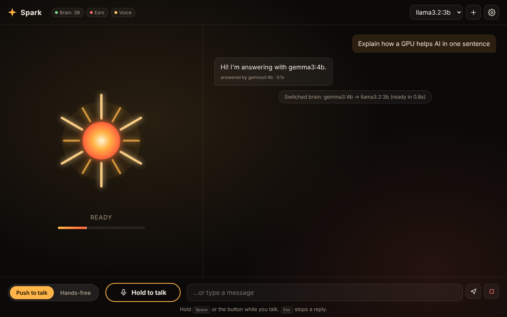

# Spark

Offline voice chat for a Windows PC with an NVIDIA RTX 3050 (6 GB). Talk through a headset; Spark listens, thinks on the graphics card and talks back. Nothing leaves the computer.

- **Ears:** Whisper `small.en` on the CPU
- **Brain:** Ollama on the GPU — `gemma3:4b` (default) and `llama3.2:3b` (fastest)
- **Voice:** Piper (Ryan, Lessac, Cori, Joe)
- **Push to talk / Hands-free** toggle, talk-over-to-interrupt, headset picker, editable personality
- **One-click updates** from the gear menu or the *Update Spark* icon

## Install (Windows 10/11)
1. Update the NVIDIA driver for the RTX 3050.
2. Download this repo (**Code → Download ZIP**) and unzip it somewhere permanent, e.g. `C:\Apps\Spark`.
3. Double-click **Install Spark.bat** (needs internet once, ~8 GB).
4. Use the **Spark** icon on the desktop.

## Update
Gear menu → **Updates → Update now**, or the **Update Spark** desktop icon. Models, voices, settings, chats and `config.json` changes are kept.

See `README.txt` for tips and troubleshooting.
